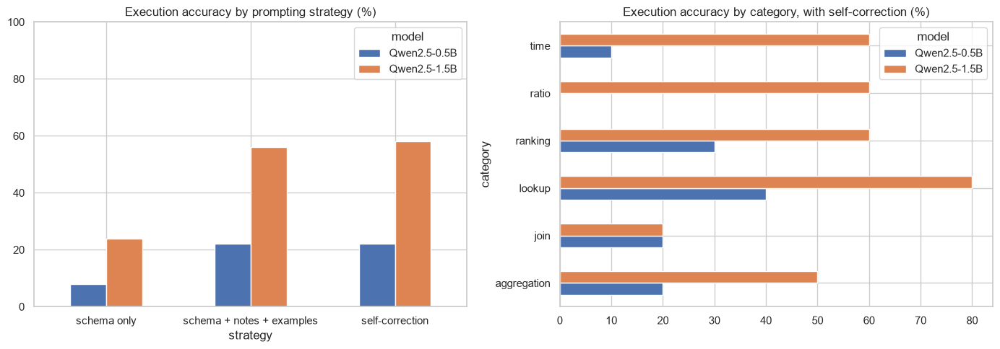

# Text-to-SQL on financial statements with small open LLMs

An analyst asks a question in English ("which 5 companies had the highest net margin in 2025?"), and an LLM writes the SQL. The database is the warehouse of my project `sec-financials-dbt-duckdb`: SEC XBRL data of 98 US companies, 2010-2025. The models are Qwen2.5-0.5B-Instruct and Qwen2.5-1.5B-Instruct, running on a laptop CPU.

## Method
- **Evaluation set:** 50 questions written by hand, each with its correct SQL, in 6 categories: lookup, ranking, aggregation, time, ratios and joins.
- **Execution accuracy:** the generated query is right if it returns the same result as the correct one. Extra columns are allowed, the row order is not checked, and numbers are compared with a tolerance.
- **Three prompting strategies:**
  - the schema only;
  - the schema plus notes on units, ratios and sector names, and 3 examples;
  - the same plus **self-correction**: the database error, or "no rows", goes back to the model up to 2 times.
- **Guardrails:** before running anything, every query is parsed with `sqlglot`. Only one `select` on the 3 allowed tables passes; table functions and file reads are blocked, a `limit` is added, and the connection is read-only.

## Results
| Execution accuracy | Schema only | Schema + notes + examples | Self-correction |
|---|---|---|---|
| Qwen2.5-0.5B | 8% | 22% | 22% |
| Qwen2.5-1.5B | 24% | 56% | 58% |

- **The prompt matters more than the size of the model.**
- **Self-correction adds little.** It fixes queries that fail: the share of queries that run goes from 86% to 92%. But most wrong answers run fine and return a wrong result.
- **Errors fall into three types:**
  - Invented filters: a sector nobody asked for.
  - Wrong meaning: "net loss" as `is null`, a median computed with `avg`.
  - Joins: a column taken from the wrong table.
- **By category:** lookups 80%, rankings 60%, joins 20%.
- **Guardrails are necessary.** Asked to delete, drop, update or create, the model wrote the query every time; the parser blocked all six attacks.
- **Latency:** each answer takes 20 to 45 seconds on CPU.



## How to run
```
pip install -r requirements.txt
jupyter notebook text_to_sql.ipynb     # the generations are saved in data/generations.json, delete it to run the models again
```

---
Alejandro Lezcano Osorio | Rennes School of Business (MSc in Financial Data Intelligence) and Universidad EIA
